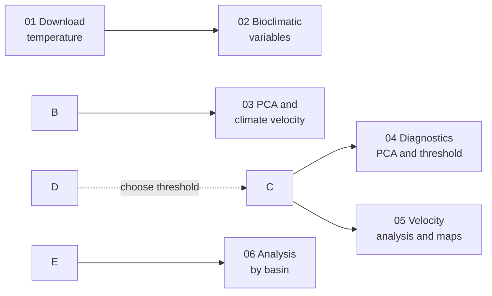

# 3D climate change velocity

Code to compute **analogue-based 3D climate velocity** in marine environments, applied to the whole water column of the Mediterranean Sea.

Companion code to:

> Rizzi A., Menegon S., Fianchini M., Melaku Canu D., Gissi E. (2026). Exploring climate change exposure of the Mediterranean Sea through 3D climate velocity. \*Ecological Indicators\*, 188, 115018. https://doi.org/10.1016/j.ecolind.2026.115018

\---

## Overview

For each cell of a 3D ocean grid (depth, lat, lon), the method looks for the **closest future cell with a similar present climate** (the forward climate analogue). The distance to the analogue, split into a horizontal and a vertical component, is the displacement needed to track present climate conditions; dividing it by the period length gives the climate velocity.

* **Data:** daily sea water potential temperature, POLCOMS-ERSEM, RCP8.5 (Copernicus Climate Data Store)
* **Periods:** present 2006–2030, future 2031–2055
* **Climate space:** 9 bioclimatic variables summarised by PCA (3 components)
* **Runs:** whole water column, four biozones (euphotic, mesophotic, mesopelagic, bathyabyssopelagic) and seabed

## Workflow



|Step|Script|What it does|Main outputs|
|-|-|-|-|
|1|[`01\_download\_data.py`](code/01_download_data.py)|Downloads daily 3D temperature from the CDS and builds present and future files, masking the Atlantic|`\*\_present\_thetao.nc`, `\*\_future\_thetao.nc`|
|2|[`02\_bioclimatic\_variables.py`](code/02_bioclimatic_variables.py)|Computes bioclimatic variables (bio1–bio7, bio10, bio11) for each cell|`\*\_t1\_bio.nc`, `\*\_t2\_bio.nc`, `pre-pca\_dft\*.csv`|
|3|[`03\_climate\_velocity.py`](code/03_climate_velocity.py)|PCA on the present climate, forward analogue search and 3D displacement|`{range}\_dist\_vel\_{threshold}.nc`, `{range}\_no\_analogue\_{threshold}.csv`|
|4|[`04\_diagnostics.py`](code/04_diagnostics.py)|Explained variance, PCA loadings and threshold sensitivity|PNG figures|
|5|[`05\_velocity\_analysis.py`](code/05_velocity_analysis.py)|Statistics, displacement types, direction roses, velocity maps and depth profiles|PNG figures|
|6|[`06\_basin\_analysis.py`](code/06_basin_analysis.py)|Repeats step 5 for each Mediterranean basin|`basin\_stats\_\*.csv`, PNG figures|

## Installation

```bash
git clone https://github.com/alessiarizzi/3D-climate-change-velocity.git
cd 3D-climate-change-velocity
conda env create -f environment.yml
conda activate climate-velocity-3d
```

Step 1 needs a [Copernicus CDS](https://cds.climate.copernicus.eu/) account with the API key in `\~/.cdsapirc`.

## Usage

Run the scripts in order from the repository root:

```bash
python code/01\_download\_data.py
python code/02\_bioclimatic\_variables.py
python code/03\_climate\_velocity.py
python code/04\_diagnostics.py
python code/05\_velocity\_analysis.py
python code/06\_basin\_analysis.py
```

**Choosing the analogue threshold.** Set `run\_sensitivity = True` in step 3 to compute the depth-range runs for all thresholds in `sensitivity\_thresholds`, then run step 4 to compare them. Set the chosen value as `nn\_threshold` (step 3) and `threshold` (step 5).

**Main parameters**

|Parameter|Script|Default|Meaning|
|-|-|-|-|
|`first\_year`, `split\_year`, `last\_year`|01|2006, 2031, 2055|Present and future periods|
|`nn\_threshold`|03|0.1|Maximum distance in PCA space for a cell to count as an analogue|
|`depth\_ranges`|03, 05|0–50, 30–250, 200–1250, 1000–5500 m|Biozones|
|`n\_years`|05|25|Period length, converts displacement to velocity|

Step 3 saves progress after each chunk, so an interrupted run can be restarted. Delete `data/outputs/progress\_file/` after changing the inputs or `chunk\_size`.

## Data

Temperature data are downloaded from the Copernicus Climate Data Store (dataset `sis-marine-properties`) and are not redistributed here. Steps 5 and 6 also need:

* `data/shapefiles/med\_sea.shp`: Mediterranean Sea polygon
* `data/sub-basins\_med.csv`: sub-basin codes and bounding boxes (columns `Code`, `lat\_min`, `lat\_max`, `lon\_min`, `lon\_max`)

```
data/
├── shapefiles/med\_sea.shp
├── sub-basins\_med.csv
└── outputs/            # created by the scripts
```

## Citation

If you use this code, please cite the paper above and the software release:

> Rizzi A. (2026). 3D climate change velocity (Version X.X.X) \[Software]. Zenodo. https://doi.org/10.5281/zenodo.18340030


## License

Released under the [MIT License](LICENSE).

## 

